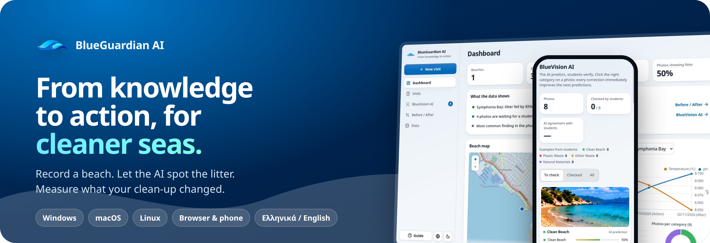
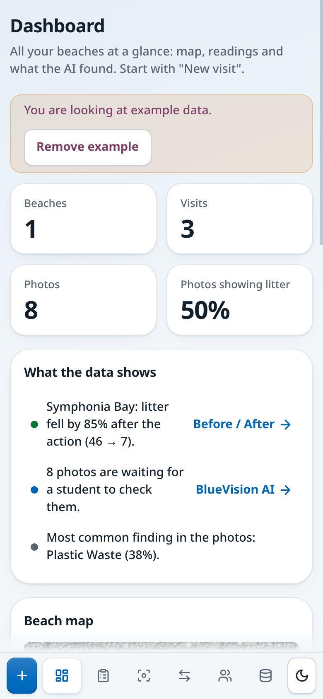
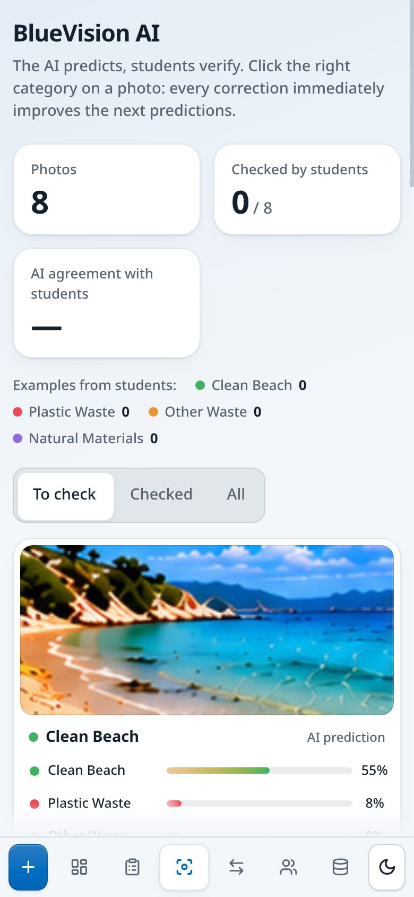
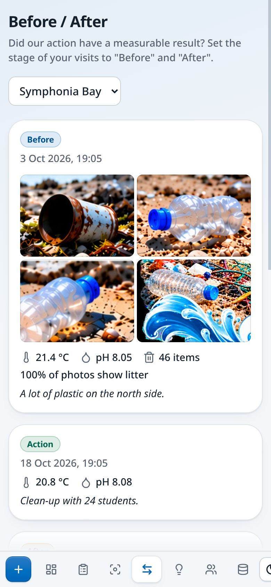
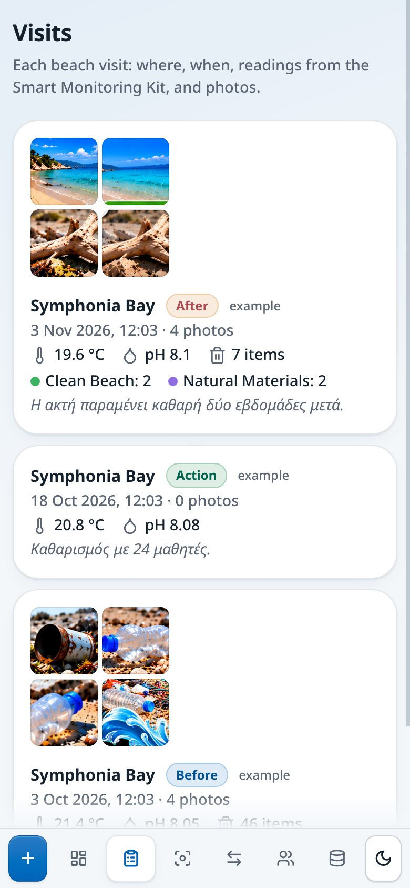
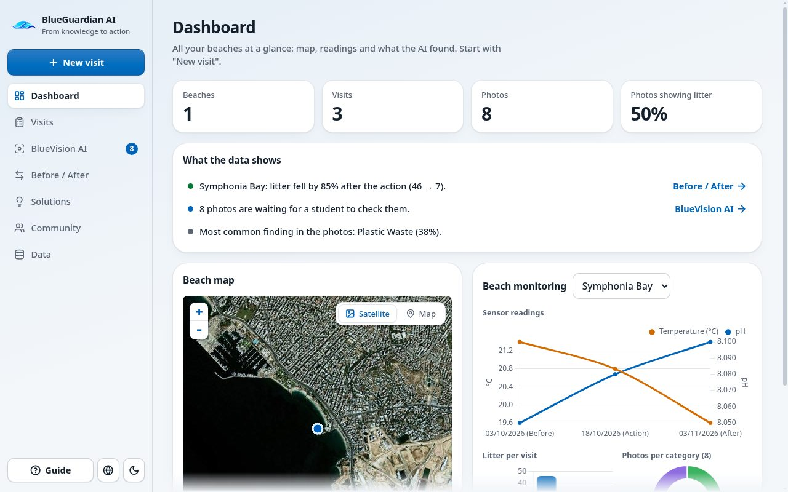
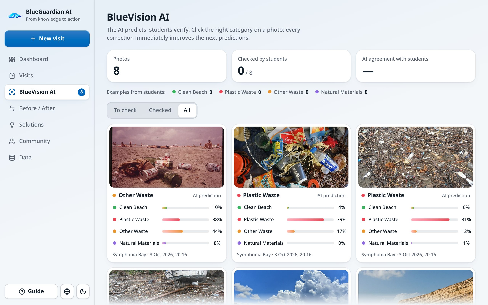

<a href="https://blueguardianai.gr/"></a>

<div align="center">

[](https://github.com/blueguardianai/blueguardian-ai/releases/latest)
[](https://github.com/blueguardianai/blueguardian-ai/releases)
[](https://github.com/blueguardianai/blueguardian-ai/actions/workflows/release.yml)
[](https://blueguardianai.gr/)
[](LICENSE)

### [Open in the browser →](https://blueguardianai.gr/app/)

Works on any computer, tablet or phone. Free, no account, nothing to install.

[](https://github.com/blueguardianai/blueguardian-ai/releases/latest/download/BlueGuardian-AI-Setup.exe)
[](https://github.com/blueguardianai/blueguardian-ai/releases/latest/download/BlueGuardian-AI-mac-arm64.dmg)
[](https://github.com/blueguardianai/blueguardian-ai/releases/latest/download/BlueGuardian-AI.deb)
[](https://github.com/blueguardianai/blueguardian-ai/releases/latest/download/BlueGuardian-AI.AppImage)

[Website](https://blueguardianai.gr/) ·
[Download notes](#download) ·
[Privacy](https://blueguardianai.gr/privacy.html) ·
[Ελληνικά](README.md)

</div>

## What it does

| | |
|---|---|
| **Visits** | Each trip to the beach: a spot on the map, the date, water temperature, pH, litter count and photos. |
| **BlueVision AI** | Sorts every photo into Clean Beach, Plastic Waste, Other Waste or Natural Materials, and always shows how confident it is. |
| **People decide** | Students check the predictions. Every correction becomes an example, and similar photos update straight away. |
| **Before / After** | Puts the state before, the day of the action and the state after side by side, and works out the difference. |
| **Dashboard** | A high-resolution satellite map, charts per beach, and findings in plain language. |
| **3D Innovation Lab** | Design prototypes in Tinkercad for a 3D printer (12 projects, such as the Smart River Gate, Floating Waste Collector and Smart Coastal Station) and track the cycle: design, build, test, measure, improve. |
| **Save Symphonia Bay** | A strategy game for the classroom: four roles, few resources and 16 event cards. Three sizes (Mini 5, Classic 8, Big 12 rounds) and three difficulty levels. Data helps, but people decide. |
| **Community** | If you want, you share a visit under your school's name. Every shared visit appears on one common map. |
| **PDF report** | A printable report per beach, with charts, findings, before/after and a QR code that opens a new visit there. Litter counts are compared with 8 Greek beaches from the MIO-ECSDE & HELMEPA survey (2018). |
| **Open data** | Export every visit to CSV, and back everything up to one file. |

### On your phone

<table align="center"><tr><td align="center"><br><sub><b>Dashboard</b></sub></td><td align="center"><br><sub><b>BlueVision AI</b></sub></td><td align="center"><br><sub><b>Before / After</b></sub></td><td align="center"><br><sub><b>Visits</b></sub></td></tr></table>

### On your computer



<p align="center">
  
  
</p>

## Download

| System | File | Note |
|---|---|---|
| **Browser** | [Open the app](https://blueguardianai.gr/app/) | Computer, tablet or phone. Nothing to install. |
| **Windows** 10 / 11 | [BlueGuardian-AI-Setup.exe](https://github.com/blueguardianai/blueguardian-ai/releases/latest/download/BlueGuardian-AI-Setup.exe) | At the SmartScreen warning: "More info" → "Run anyway". |
| **macOS** Apple Silicon | [BlueGuardian-AI-mac-arm64.dmg](https://github.com/blueguardianai/blueguardian-ai/releases/latest/download/BlueGuardian-AI-mac-arm64.dmg) | The first time: right-click the app → "Open". |
| **macOS** Intel | [Browser app](https://blueguardianai.gr/app/) | The desktop AI engine has no Intel Mac build. |
| **Linux** Debian / Ubuntu / Mint | [BlueGuardian-AI.deb](https://github.com/blueguardianai/blueguardian-ai/releases/latest/download/BlueGuardian-AI.deb) | `sudo apt install ./BlueGuardian-AI.deb` |
| **Linux** any distribution | [BlueGuardian-AI.AppImage](https://github.com/blueguardianai/blueguardian-ai/releases/latest/download/BlueGuardian-AI.AppImage) | `chmod +x BlueGuardian-AI.AppImage`, then run it. |

The desktop apps are about 700 MB because they include the large AI model and work fully offline.
They are not code-signed, so Windows and macOS ask once before opening them.

## How it works

1. **Observe.** Go to the beach and photograph what you find on the shore.
2. **Measure.** Note the water temperature, pH and how much litter you counted.
3. **Understand.** The AI sorts the photos and the dashboard shows what changes over time.
4. **Act and measure again.** After your action, record again and compare.

On first launch the app offers an example beach and a four-step guide.

## Your data

- Everything stays on your device: on the computer for the desktop app, in the browser for the website.
- There are no accounts. The AI runs locally.
- Only what you choose is shared, with the "Share" button. See [exactly what, and how to remove it](https://blueguardianai.gr/privacy.html).
- Only the maps load from the internet (OpenStreetMap and Esri).
- The "Data" page makes a backup file and moves your data to another device.

## The AI

BlueVision AI is built on CLIP, a pretrained model that compares images with text descriptions.
Nothing was trained from scratch: each category is defined by a few descriptions in [`src/ai/classes.json`](src/ai/classes.json).

When a student corrects a photo, it is stored as an example.
In later predictions, photos that look like the example lean towards its category ([`src/ai/predict.js`](src/ai/predict.js)).

| | Model | Size |
|---|---|---|
| Desktop app | CLIP ViT-L/14 | 608 MB, bundled |
| Website | CLIP ViT-B/32 (quantized) | 89 MB, downloaded on first use |

The AI makes mistakes, especially on photos with many objects. That is why human checking is part of the app and not optional.

## For developers

<details>
<summary>Build, layout and releasing</summary>

One codebase, two targets: an Electron app and a static website. Secret keys live in Supabase, never in the repository.

```sh
npm install
npm run prepare-model   # downloads both models once (models/ and src/ai/text-embeds*.json)
npm start               # desktop app
npm run web             # builds dist/web and serves it at http://localhost:8080
npm test
```

| Folder | Contents |
|---|---|
| `src/` | The app, shared by desktop and website. `app.js` UI, `i18n.js` texts, `ai/` prediction. |
| `preload.js`, `src/platform-web.js` | The two implementations of storage and AI. A cloud backend would be a third. |
| `main.js`, `src/sw.js` | Electron main process, and the website's service worker (photos, offline use). |
| `src/cloud.js`, `supabase/` | The community: client, database schema, and the function that checks every share. |
| `site/` | The website's landing page. |
| `scripts/` | Model preparation and the website build. |

**Releasing:** every push to `main` publishes the website. A tag builds the Windows, macOS and Linux installers and uploads them to the Release:

```sh
git tag v1.0.1 && git push origin v1.0.1
```

</details>

## The team

BlueGuardian AI is a project by the **BlueGuardian AI** student team of the **3rd Junior High School of Argyroupoli**, Greece.

Maps: [OpenStreetMap](https://www.openstreetmap.org/copyright).
Satellite imagery: Esri, Maxar, Earthstar Geographics.
Model: OpenAI's [CLIP](https://github.com/openai/CLIP), in ONNX form from [Transformers.js](https://github.com/huggingface/transformers.js).

## License

Open source under the [MIT](LICENSE) license. Contact: BlueGuardianAI@gmail.com
