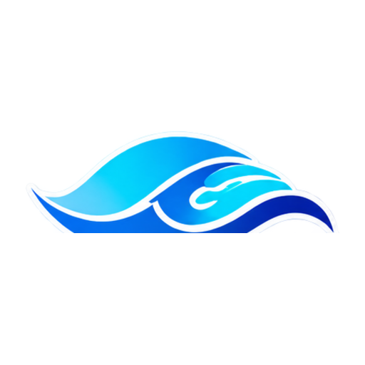
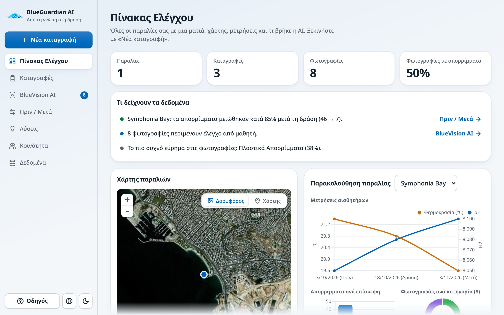
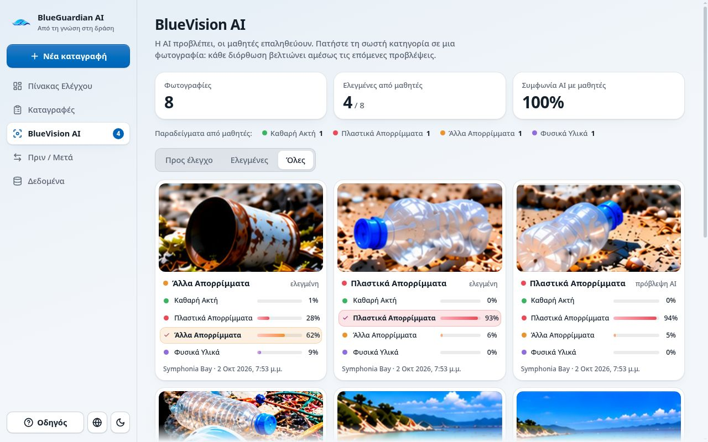
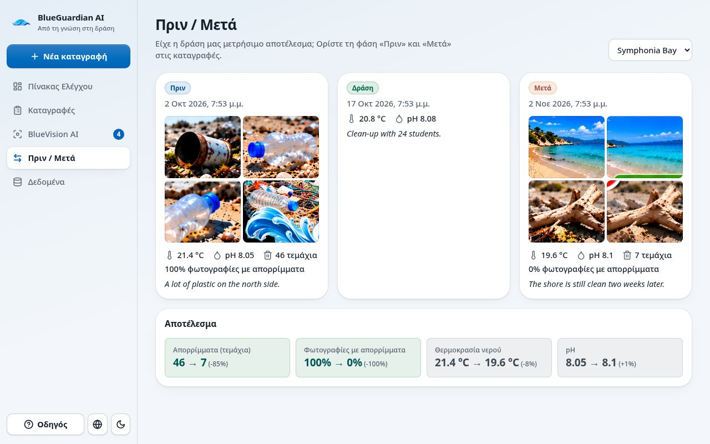

<div align="center">



# BlueGuardian AI

**Από τη γνώση στη δράση, για πιο καθαρές θάλασσες.**

Καταγράψτε μια παραλία με φωτογραφίες και μετρήσεις, αφήστε την AI να αναγνωρίσει τα απορρίμματα,
και δείτε με αριθμούς αν η δράση σας είχε αποτέλεσμα.

[**Άνοιγμα στον browser**](https://blueguardianai.github.io/blueguardian-ai/app/) ·
[Ιστότοπος](https://blueguardianai.github.io/blueguardian-ai/) ·
[Λήψη](#λήψη) ·
[English](README.en.md)



</div>

## Τι κάνει

| | |
|---|---|
| **Καταγραφές** | Κάθε επίσκεψη στην παραλία: σημείο στον χάρτη, ημερομηνία, θερμοκρασία νερού, pH, αριθμός απορριμμάτων και φωτογραφίες. |
| **BlueVision AI** | Κατατάσσει κάθε φωτογραφία σε Καθαρή Ακτή, Πλαστικά Απορρίμματα, Άλλα Απορρίμματα ή Φυσικά Υλικά, και δείχνει πάντα πόσο σίγουρη είναι. |
| **Ο άνθρωπος αποφασίζει** | Οι μαθητές ελέγχουν τις προβλέψεις. Κάθε διόρθωση γίνεται παράδειγμα και οι παρόμοιες φωτογραφίες ενημερώνονται αμέσως. |
| **Πριν / Μετά** | Βάζει δίπλα δίπλα την κατάσταση πριν, την ημέρα της δράσης και την κατάσταση μετά, και υπολογίζει τη διαφορά. |
| **Πίνακας ελέγχου** | Δορυφορικός χάρτης υψηλής ανάλυσης, γραφήματα ανά παραλία και ευρήματα σε απλά λόγια. |
| **Κοινότητα** | Αν θέλετε, μοιράζεστε μια καταγραφή με το όνομα του σχολείου σας. Όλες οι κοινόχρηστες καταγραφές φαίνονται σε έναν κοινό χάρτη. |
| **Ανοιχτά δεδομένα** | Εξαγωγή όλων των καταγραφών σε CSV και αντίγραφο ασφαλείας σε ένα αρχείο. |

<p align="center">
  
  
</p>

## Λήψη

| Σύστημα | Αρχείο | Σημείωση |
|---|---|---|
| **Browser** | [Άνοιγμα εφαρμογής](https://blueguardianai.github.io/blueguardian-ai/app/) | Υπολογιστής, tablet ή κινητό. Χωρίς εγκατάσταση. |
| **Windows** 10 / 11 | [BlueGuardian-AI-Setup.exe](https://github.com/blueguardianai/blueguardian-ai/releases/latest/download/BlueGuardian-AI-Setup.exe) | Στην προειδοποίηση SmartScreen: «Περισσότερες πληροφορίες» → «Εκτέλεση». |
| **macOS** Apple Silicon | [BlueGuardian-AI-mac-arm64.dmg](https://github.com/blueguardianai/blueguardian-ai/releases/latest/download/BlueGuardian-AI-mac-arm64.dmg) | Την πρώτη φορά: δεξί κλικ στην εφαρμογή → «Άνοιγμα». |
| **macOS** Intel | [Εφαρμογή στον browser](https://blueguardianai.github.io/blueguardian-ai/app/) | Το AI της εφαρμογής υπολογιστή δεν υπάρχει για Intel Mac. |
| **Linux** Debian / Ubuntu / Mint | [BlueGuardian-AI.deb](https://github.com/blueguardianai/blueguardian-ai/releases/latest/download/BlueGuardian-AI.deb) | `sudo apt install ./BlueGuardian-AI.deb` |
| **Linux** κάθε διανομή | [BlueGuardian-AI.AppImage](https://github.com/blueguardianai/blueguardian-ai/releases/latest/download/BlueGuardian-AI.AppImage) | `chmod +x BlueGuardian-AI.AppImage` και εκτέλεση. |

Οι εφαρμογές για υπολογιστή είναι περίπου 700 MB, επειδή περιέχουν το μεγάλο μοντέλο AI και δουλεύουν πλήρως χωρίς σύνδεση.
Δεν είναι ψηφιακά υπογεγραμμένες, γι' αυτό τα Windows και το macOS ρωτούν μία φορά πριν τις ανοίξουν.

## Πώς λειτουργεί

1. **Παρατηρούμε.** Πηγαίνετε στην παραλία και φωτογραφίζετε ό,τι βρίσκετε στην ακτή.
2. **Μετράμε.** Σημειώνετε θερμοκρασία νερού, pH και πόσα απορρίμματα μετρήσατε.
3. **Κατανοούμε.** Η AI κατατάσσει τις φωτογραφίες και ο πίνακας ελέγχου δείχνει τι αλλάζει με τον χρόνο.
4. **Δρούμε και ξαναμετράμε.** Μετά τη δράση καταγράφετε ξανά και συγκρίνετε.

Στην πρώτη εκκίνηση η εφαρμογή προτείνει μια παραλία-παράδειγμα και έναν οδηγό τεσσάρων βημάτων.

## Τα δεδομένα σας

- Όλα μένουν στη συσκευή σας: στον υπολογιστή για την εφαρμογή, στον browser για τον ιστότοπο.
- Δεν υπάρχουν λογαριασμοί. Η AI τρέχει τοπικά.
- Κοινοποιείται μόνο ό,τι επιλέξετε, με το κουμπί «Κοινοποίηση». Δείτε [τι ακριβώς και πώς αφαιρείται](https://blueguardianai.github.io/blueguardian-ai/privacy.html).
- Μόνο οι χάρτες φορτώνουν από το διαδίκτυο (OpenStreetMap και EOX).
- Από τη σελίδα «Δεδομένα» κρατάτε αντίγραφο ασφαλείας και μεταφέρετε τα δεδομένα σε άλλη συσκευή.

## Η τεχνητή νοημοσύνη

Το BlueVision AI βασίζεται στο CLIP, ένα προεκπαιδευμένο μοντέλο που συγκρίνει εικόνες με περιγραφές σε κείμενο.
Δεν χρειάστηκε εκπαίδευση από την αρχή: κάθε κατηγορία ορίζεται με λίγες περιγραφές στο [`src/ai/classes.json`](src/ai/classes.json).

Όταν ένας μαθητής διορθώσει μια φωτογραφία, αυτή αποθηκεύεται ως παράδειγμα.
Στις επόμενες προβλέψεις, οι φωτογραφίες που μοιάζουν με το παράδειγμα γέρνουν προς την κατηγορία του ([`src/ai/predict.js`](src/ai/predict.js)).

| | Μοντέλο | Μέγεθος |
|---|---|---|
| Εφαρμογή για υπολογιστή | CLIP ViT-L/14 | 608 MB, μέσα στην εφαρμογή |
| Ιστότοπος | CLIP ViT-B/32 (quantized) | 89 MB, κατεβαίνει την πρώτη φορά |

Η AI κάνει λάθη, ιδιαίτερα σε φωτογραφίες με πολλά αντικείμενα. Γι' αυτό ο έλεγχος από άνθρωπο είναι μέρος της εφαρμογής και όχι προαιρετικός.

## Για προγραμματιστές

Ένας κώδικας, δύο στόχοι: εφαρμογή Electron και στατικός ιστότοπος. Τα μυστικά κλειδιά μένουν στη Supabase, ποτέ στο αποθετήριο.

```sh
npm install
npm run prepare-model   # κατεβάζει τα δύο μοντέλα μία φορά (models/ και src/ai/text-embeds*.json)
npm start               # εφαρμογή για υπολογιστή
npm run web             # χτίζει το dist/web και το σερβίρει στο http://localhost:8080
npm test
```

| Φάκελος | Περιεχόμενο |
|---|---|
| `src/` | Η εφαρμογή, κοινή για υπολογιστή και ιστότοπο. `app.js` διεπαφή, `i18n.js` κείμενα, `ai/` πρόβλεψη. |
| `preload.js`, `src/platform-web.js` | Οι δύο υλοποιήσεις αποθήκευσης και AI. Ένα cloud backend θα ήταν η τρίτη. |
| `main.js`, `src/sw.js` | Κύρια διεργασία Electron, και service worker του ιστότοπου (φωτογραφίες, λειτουργία χωρίς σύνδεση). |
| `src/cloud.js`, `supabase/` | Η κοινότητα: πελάτης, σχήμα βάσης και η συνάρτηση που ελέγχει κάθε κοινοποίηση. |
| `site/` | Η αρχική σελίδα του ιστότοπου. |
| `scripts/` | Προετοιμασία μοντέλων και χτίσιμο του ιστότοπου. |

**Έκδοση:** κάθε push στο `main` δημοσιεύει τον ιστότοπο. Ένα tag χτίζει τα προγράμματα εγκατάστασης για Windows, macOS και Linux και τα ανεβάζει στο Release:

```sh
git tag v1.0.1 && git push origin v1.0.1
```

## Η ομάδα

Το BlueGuardian AI είναι έργο της μαθητικής ομάδας **Sea Symphony** του **3ου Γυμνασίου Αργυρούπολης**.

Χάρτες: [OpenStreetMap](https://www.openstreetmap.org/copyright).
Δορυφορικές εικόνες: Esri, Maxar, Earthstar Geographics.
Μοντέλο: [CLIP](https://github.com/openai/CLIP) της OpenAI, σε μορφή ONNX από το [Transformers.js](https://github.com/huggingface/transformers.js).
